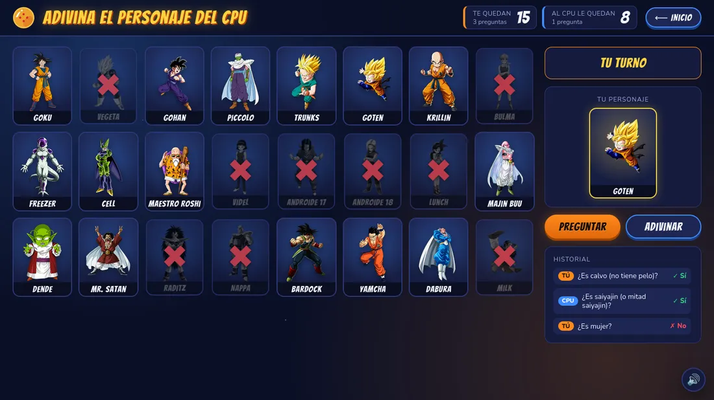
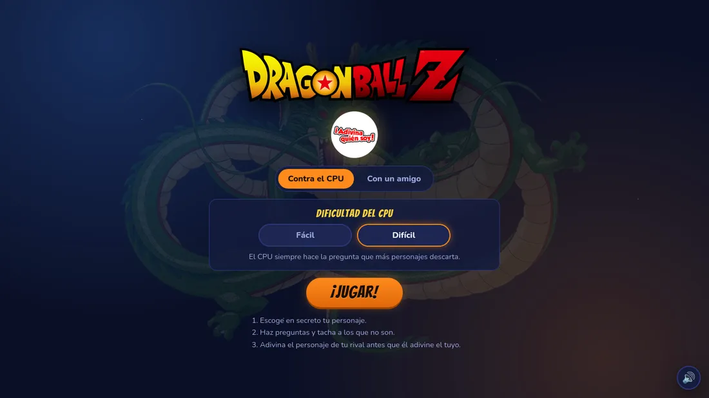
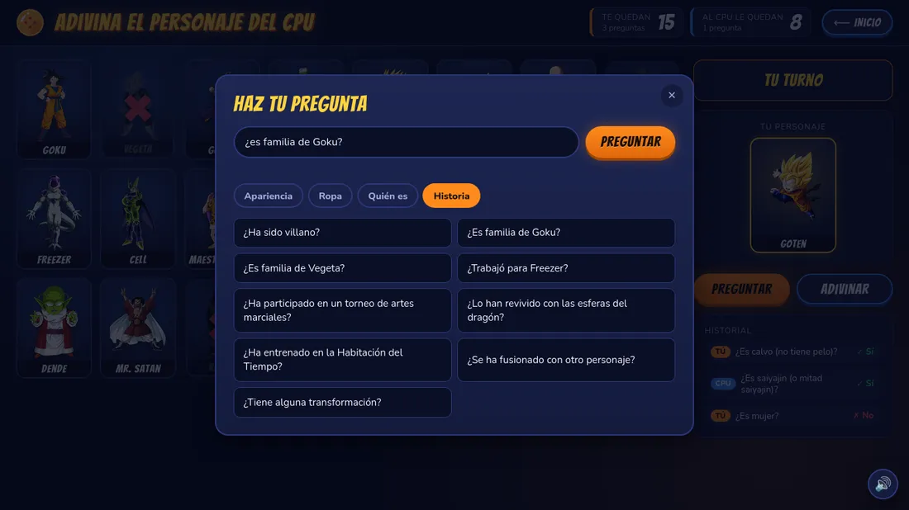
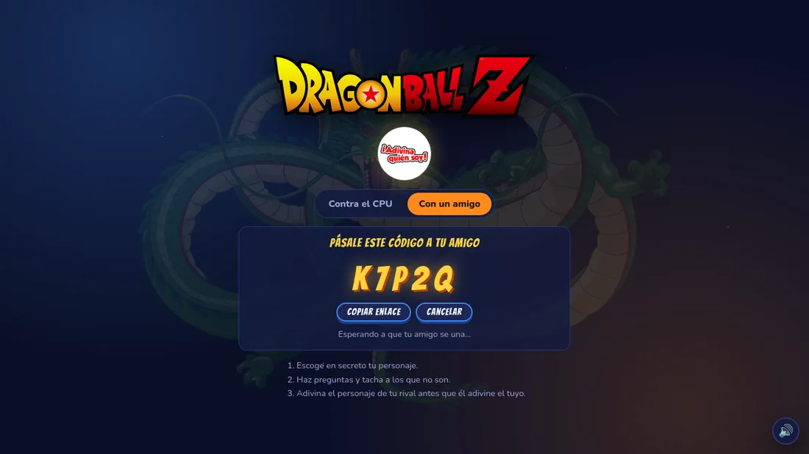
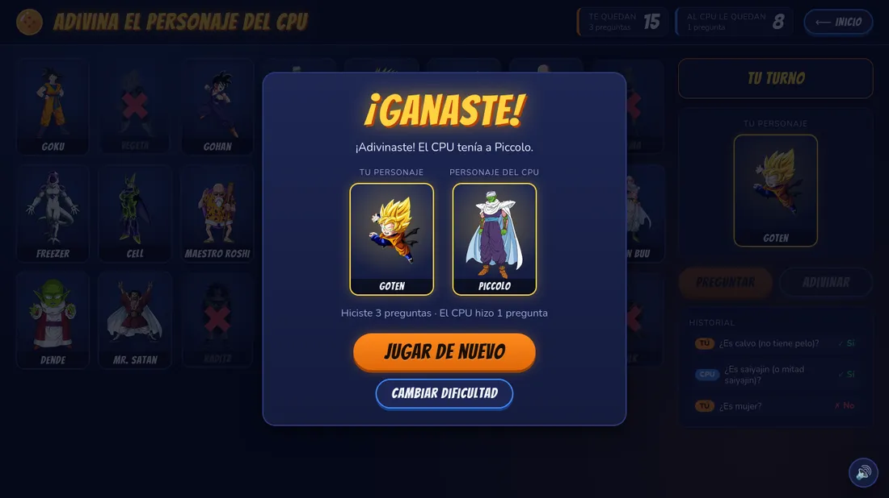

# Adivina Quién · Dragon Ball Z

Juego de **¿Adivina quién?** con 24 personajes de Dragon Ball Z, hecho con HTML, CSS y JavaScript puro. Puedes jugar contra la computadora o en línea contra un amigo.

> 🎓 **Proyecto final escolar.** Empezó como el proyecto final de la escuela y después lo mejoré: rediseño completo, más preguntas, una CPU más inteligente, multijugador en línea y efectos de sonido.



## Capturas

| Pantalla de inicio | Hacer una pregunta |
|---|---|
|  |  |
| **Sala para jugar con un amigo** | **Fin de la partida** |
|  |  |

## Cómo se juega

1. Escoge en secreto tu personaje.
2. En tu turno, haz una pregunta de sí o no sobre el personaje de tu rival.
3. Tacha (haciendo clic) a los personajes que ya no pueden ser.
4. Cuando creas saberlo, pulsa **Adivinar** y elige a su personaje. Si fallas, pierdes.
5. Gana quien adivine primero el personaje del otro.

## Características

- **Dos modos de juego**
  - **Contra el CPU**, con dificultad *Fácil* (pregunta al azar) o *Difícil* (hace siempre la mejor pregunta).
  - **Con un amigo en línea**: uno crea una sala, le pasa el código de 5 letras (o el enlace) y juegan desde cualquier lugar.
- **30 preguntas** en 4 categorías: Apariencia, Ropa, Quién es e Historia.
- **Preguntas escritas**: también puedes escribir "¿es rubio?" o "¿murió alguna vez?" y el juego entiende a qué pregunta te refieres.
- Las preguntas ya hechas quedan **bloqueadas** y muestran su respuesta.
- **Historial** con todas las preguntas y respuestas de los dos jugadores.
- **Contadores** de cuántos personajes le quedan a cada uno.
- **Efectos de sonido** estilo Dragon Ball (carga de ki, teletransportación, rastreador…) con botón para silenciar.
- **Diseño adaptable**: funciona en computadora, tablet y celular.

## Cómo ejecutarlo

No necesita instalar nada: abre `index.html` en el navegador.

El modo **Con un amigo** necesita internet, porque usa [PeerJS](https://peerjs.com/) para conectar los dos navegadores.

### Publicarlo en GitHub Pages

1. Sube el proyecto a un repositorio de GitHub.
2. En el repositorio entra a **Settings → Pages**.
3. En **Branch** elige `main` y la carpeta `/ (root)`, y guarda.
4. En un par de minutos el juego estará en `https://TU-USUARIO.github.io/NOMBRE-DEL-REPO/`.

## Cómo funciona por dentro

### La CPU elige la mejor pregunta

En modo difícil, la CPU revisa todas las preguntas que le quedan y escoge la que divide a sus personajes posibles **lo más cerca posible de la mitad**: así, sin importar si la respuesta es sí o no, descarta a la mitad. Es la misma idea que la **búsqueda binaria**: con 24 personajes necesita unas 5 preguntas (2⁵ = 32).

| Dificultad | Preguntas que necesita la CPU |
|---|---|
| Fácil (al azar) | 9.7 en promedio |
| Difícil (mejor pregunta) | 4.7 en promedio, nunca más de 5 |

### Preguntas escritas

Cada pregunta tiene grupos de palabras clave. El texto escrito se pasa a minúsculas, se le quitan los acentos y los signos, y se busca qué pregunta tiene al menos una palabra de cada grupo. Por ejemplo, *"¿tiene el pelo negro?"* encaja con `[pelo, cabello] + [negro, oscuro]`.

### Multijugador sin servidor propio

PeerJS conecta los dos navegadores directamente (WebRTC), por eso funciona en GitHub Pages. Para que nadie pueda hacer trampa, **tu personaje nunca se envía** durante la partida: tu amigo manda la pregunta, tu navegador calcula la respuesta y solo devuelve sí o no. Los personajes se revelan al terminar.

### Sonidos propios

Los efectos no se descargaron de internet: se generan con el script `herramientas/generar_sonidos.py` combinando ondas, ruido y filtros. Para cambiarlos, edita el script y ejecuta:

```bash
python3 herramientas/generar_sonidos.py
```

## Estructura del proyecto

```
├── index.html                 Páginas del juego (inicio, tablero y ventanas)
├── css/styles.css             Estilos y diseño adaptable
├── js/
│   ├── main.js                Personajes, preguntas y lógica del juego
│   ├── multijugador.js        Conexión en línea con PeerJS
│   └── sonidos.js             Efectos de sonido y botón de silencio
├── img/                       Imágenes de los personajes y logos
├── sonidos/                   Efectos de sonido (.wav)
├── capturas/                  Capturas para este README
└── herramientas/
    └── generar_sonidos.py     Script que crea los sonidos
```

## Tecnologías

- HTML, CSS y JavaScript (sin frameworks)
- [PeerJS](https://peerjs.com/) para el multijugador
- Fuentes [Bangers](https://fonts.google.com/specimen/Bangers) y [Nunito](https://fonts.google.com/specimen/Nunito) de Google Fonts
- Python (solo para generar los sonidos)

## Aviso

Proyecto escolar sin fines de lucro, hecho por un fan. *Dragon Ball Z* y sus personajes son propiedad de Akira Toriyama / Bird Studio, Shueisha y Toei Animation. Las imágenes de los personajes pertenecen a sus respectivos dueños.
